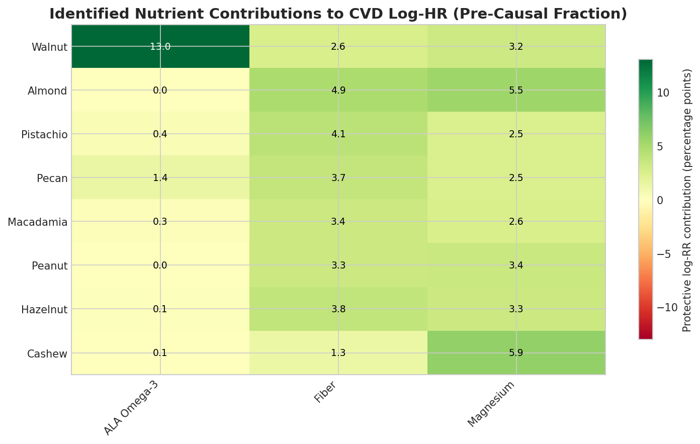
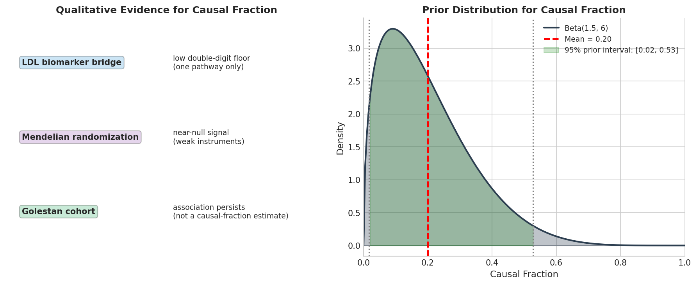
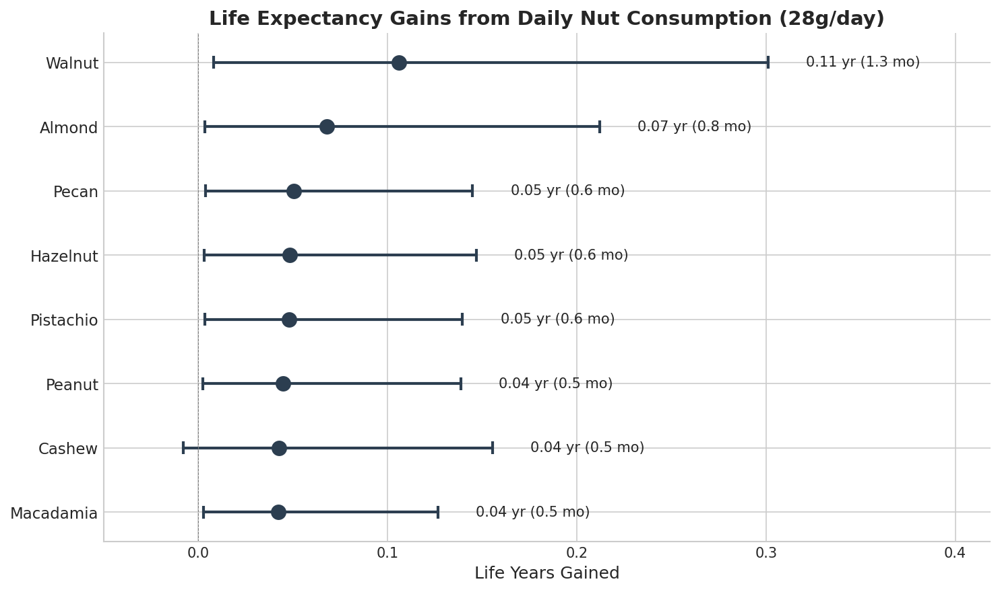
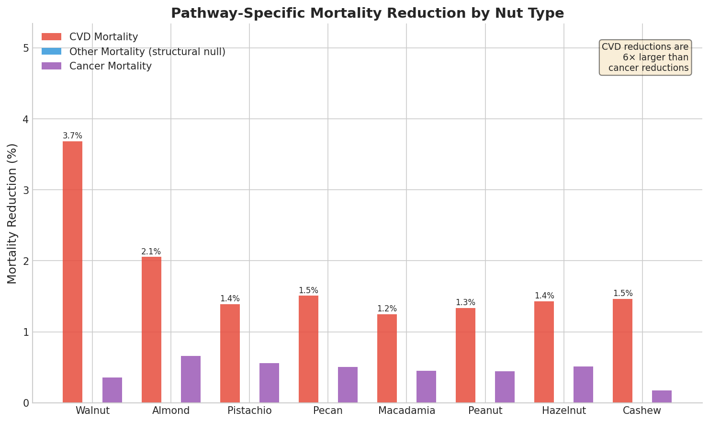
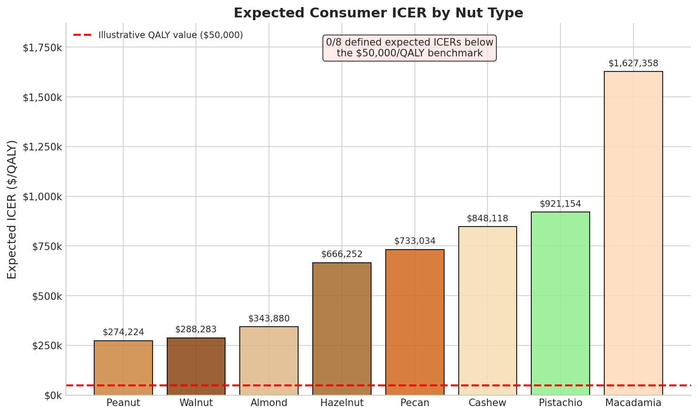

```{python}
#| echo: false
#| output: false
from whatnut.figures import generate_all_figures

generate_all_figures()
from whatnut.results import r
```

## Abstract

**Objectives.** Prospective cohorts associate nut consumption with lower mortality, but an observed dietary association does not by itself identify the effect of adding nuts to a person's diet. I estimate a deliberately partial benchmark: the mortality potential and gross consumer cost of adding one 28 g serving of one nut per day, conditional on no displaced food, calorie or adiposity response, adherence decay, direct morbidity effect, or direct harm.

**Methods.** The model propagates uncertainty from four outcome-matched nutrient coefficients: alpha-linolenic acid (ALA), fiber, and magnesium for cardiovascular disease (CVD) mortality, and fiber for cancer mortality. All other nutrient-pathway coefficients are structural zeros. A Beta(`{python} r.confounding_alpha`, `{python} r.confounding_beta`) prior, with mean `{python} f"{r.confounding_mean:.0%}"`, represents the fraction of each sampled log-relative-risk carried into the causal benchmark. `{python} f"{r.n_samples:,}"` paired draws are translated through exact CDC 2021 single-age death probabilities using an age-specific competing-risk hazard model, a terminal interval at age 100, half-cycle occupancy, published US EQ-5D-5L age-band means, and midpoint discounting. The primary consumer scenario discounts health and gross retail cost at 3% and evaluates all nuts with a no-modeled-nut comparator at $`{python} f"{r.willingness_to_pay:,.0f}"`/QALY.

**Results.** For a `{python} r.target_age`-year-old US resident, mean gains across nuts range from `{python} r.life_years_range` life years (`{python} r.months_range` months) and `{python} r.qaly_range` discounted mortality-derived QALYs. **Cost aside, walnuts produce the largest expected health gain** (`{python} r.walnut.life_years_fmt` life years; `{python} r.walnut.qaly` discounted QALYs). At the illustrative valuation, `{python} r.decision_result_sentence`; peanuts are the best nut alternative by expected net monetary benefit. The comparator is optimal in `{python} f"{r.decision_summary['comparator_probability_optimal']:.2%}"` of paired draws.

**Conclusions.** The result is a partial mortality-potential benchmark, not the net causal effect of adding calories to an unchanged diet and not an individualized recommendation. Within that narrow benchmark, walnuts maximize expected health and peanuts maximize expected value among nuts, while no modeled nut addition is preferred at the stated price and QALY valuation.

## Introduction

### Evidence and identification

Nut consumption has been associated with lower coronary heart disease and mortality since the Adventist Health Study [@fraser1992possible]. Large US cohorts subsequently found that frequent nut consumers had lower all-cause and cause-specific mortality [@bao2013association], and dose-response meta-analysis estimated an all-cause mortality relative risk of 0.78 (95% CI 0.72–0.84) at 28 g/day [@aune2016nut]. Controlled feeding trials also show modest improvements in LDL cholesterol and related lipid markers [@delgobbo2015effects].

Those findings do not identify a context-free effect of adding nuts. Frequent nut consumers differ in smoking, physical activity, education, income, and overall diet [@bao2013association]. Dietary coefficients are usually estimated within a composition of total energy intake; changing one food may displace another, add calories, or change adherence over time. The same nut can therefore have different net effects when it replaces processed meat, replaces another unsaturated-fat source, or is added without displacement.

The distinction matters for cost-effectiveness. A relative association must be translated through age-specific baseline hazards to obtain absolute survival, and the economic result depends on what is purchased and what is no longer purchased. A model without current-diet and displaced-food inputs should not claim to answer that full decision problem.

### Contribution

This analysis defines a narrower estimand before sampling evidence. It compares sustained addition of one 28 g/day nut with no modeled daily-nut intervention for a 40-year-old US resident. The output mechanically transports four outcome-matched nutrient associations to each nut's composition and combines them with gross retail spending. The analysis intentionally does not assign effects to mechanistic nutrients without hard-outcome coefficients, apply substitution coefficients to a gross addition, or invent nut-specific residual advantages.

The model then asks two distinct questions:

1. Cost aside, which nut has the largest expected modeled health gain?
2. Given gross retail cost and an illustrative personal QALY value, which mutually exclusive option has the largest expected net monetary benefit?

Walnuts answer the first question; peanuts are the best nut answer to the second; and the no-addition comparator is the overall economic choice in the canonical scenario.

## Methods

### Analysis specification and estimand

The complete run contract is a frozen `AnalysisSpec`. Its canonical population starts at age `{python} r.start_age`, uses the CDC 2021 US total-population life table, and terminates at the open age-100 interval. The action is exactly one 28 g serving per day, with full adherence while alive. The mutually exclusive options are walnut, almond, pistachio, pecan, macadamia, peanut, hazelnut, cashew, and no modeled daily-nut intervention.

The gross-addition action is conditional on all of the following:

- no observed baseline diet or existing nut intake;
- no identified food or expenditure displaced by the nut;
- no calorie-surplus, energy-balance, weight, or adiposity pathway;
- no adherence decay or finite persistence;
- no direct morbidity improvement or direct adverse effect; and
- no mixed-nut stacking or interaction.

These conditions define what the output omits. They do not assert that the omitted effects are zero in the real world. I therefore call the output a **partial mortality-potential benchmark**, not a net causal gross-addition effect.

### Nut composition

Per-serving nutrient profiles come from USDA FoodData Central [@usda2024fooddata]. The model uses the versioned source values and FoodData Central identifiers rather than values copied into analysis code.

| Nut (energy per 28 g) | Fat (g) | ALA (g) | Fiber (g) | Magnesium (mg) | Protein (g) |
|---|---:|---:|---:|---:|---:|
| [Walnut (183 kcal)](https://fdc.nal.usda.gov/fdc-app.html#/food-details/170187/nutrients) | 18.3 | 2.5 | 1.9 | 44.2 | 4.3 |
| [Almond (162 kcal)](https://fdc.nal.usda.gov/fdc-app.html#/food-details/170567/nutrients) | 14.0 | 0.0 | 3.5 | 75.6 | 5.9 |
| [Pistachio (157 kcal)](https://fdc.nal.usda.gov/fdc-app.html#/food-details/170184/nutrients) | 12.7 | 0.1 | 3.0 | 33.9 | 5.7 |
| [Pecan (193 kcal)](https://fdc.nal.usda.gov/fdc-app.html#/food-details/170182/nutrients) | 20.2 | 0.3 | 2.7 | 33.9 | 2.6 |
| [Macadamia (201 kcal)](https://fdc.nal.usda.gov/fdc-app.html#/food-details/170178/nutrients) | 21.2 | 0.1 | 2.4 | 36.4 | 2.2 |
| [Peanut (159 kcal)](https://fdc.nal.usda.gov/fdc-app.html#/food-details/172430/nutrients) | 13.8 | 0.0 | 2.4 | 47.0 | 7.2 |
| [Hazelnut (176 kcal)](https://fdc.nal.usda.gov/fdc-app.html#/food-details/170581/nutrients) | 17.0 | 0.0 | 2.7 | 45.6 | 4.2 |
| [Cashew (155 kcal)](https://fdc.nal.usda.gov/fdc-app.html#/food-details/170162/nutrients) | 12.3 | 0.0 | 0.9 | 81.8 | 5.1 |

Values are per 28 g; rounding is for presentation. Peanuts are legumes but are included under the epidemiological convention that commonly groups them with tree nuts.

### Outcome-matched nutrient coefficients

The canonical model retains four Normal coefficients on the log-relative-risk scale. The coefficient mean and standard deviation are expressed per unit of nutrient in one daily serving. The table is generated from the schema-2 artifact's `evidence_registry`, rather than duplicating coefficient values in the manuscript.

```{python}
#| echo: false
from IPython.display import Markdown

rows = [
    "| Pathway | Nutrient | Normal mean | Normal SD | Unit | Evidence contrast | Source |",
    "|---|---|---:|---:|---|---|---|",
]
for item in r.evidence_registry["active_coefficients"]:
    source_label = item["source"].split(":", 1)[0]
    rows.append(
        f"| {item['pathway'].upper()} "
        f"| {item['nutrient'].replace('_', ' ').title()} "
        f"| {item['mean']:.8g} | {item['sd']:.8g} | per {item['unit']} "
        f"| {item['contrast']} | [{source_label}]({item['source_url']}) |"
    )
Markdown("\n".join(rows))
```

The active estimates come from the CVD-mortality ALA dose response in @naghshi2021ala, the CVD- and cancer-mortality fiber dose responses in @yao2023fiber, and the CVD-mortality magnesium dose response in @bagheri2021magnesium.

“Outcome-matched” describes the mortality endpoint, not identification of the action. These sources compare higher with lower dietary intake and commonly condition on energy or other dietary factors. Applying their coefficients to the nutrients in one added serving, with no named displaced food, is a modeling judgment that mechanically transports the association to the declared gross-addition benchmark.

All remaining nutrient-pathway coefficients are structural zeros. This includes the entire composite “other mortality” pathway. A structural zero means that the canonical evidence registry does not retain a mortality coefficient for the benchmark; it is not a biological claim of no effect.

This exclusion is especially important for fat composition. Evidence comparing unsaturated fat with saturated fat or carbohydrate identifies a substitution contrast [@farvid2014omega6; @wang2016fats]. Applying those estimates independently to each gram in an added nut would erase the displaced nutrient that defines the estimate. The canonical gross-addition model therefore does not do so.

{#fig-nutrients width="90%"}

### Forward uncertainty propagation

There is no likelihood and no posterior. For draw $s$, nutrient $j$, pathway $k$, and nut $i$, the model samples

$$
\beta_{sjk} \sim \mathcal{N}(\mu_{jk}, \sigma_{jk}^2),
\qquad
\theta_{sik} = \sum_j x_{ij}\beta_{sjk} - \frac{1}{2}\sum_j x_{ij}^2\sigma_{jk}^2.
$$

The half-variance term centers $E[\exp(\theta_{sik})]$ on the exponentiated meta-analytic mean. There is no cross-nutrient covariance term, no between-nut residual scale, no nut-specific random effect, no hand-authored per-nut multiplier, and no separate publication-bias residual layer.

Each draw also contains one shared causal fraction

$$
c_s \sim \operatorname{Beta}(1.5, 6.0),
\qquad HR_{sik}=\exp(c_s\theta_{sik}).
$$

The shared $c_s$ keeps nut and pathway comparisons paired. The implementation uses named PCG64 streams, so changing one uncertainty family cannot advance the random state of another. Confounding-prior sensitivities transform the same underlying uniform ranks and reuse the same coefficient draws.

{#fig-architecture width="100%"}

**Relationship to Optiqal.** What Nut has no Optiqal runtime dependency. The result artifact pins one Optiqal commit as a methodology reference for HR-centered uncertainty propagation, explicit decision specification, and the 3% health / 3% cost convention. What Nut's cause-specific competing-risk lifecycle, evidence registry, gross-addition estimand, and food-specific exclusions remain its own implementation; the provenance record states that limited scope rather than claiming numerical parity.

### Confounding calibration

The source associations remain vulnerable to residual healthy-user bias after measured adjustment. The canonical Beta(`{python} r.confounding_alpha`, `{python} r.confounding_beta`) causal-fraction prior has mean `{python} f"{r.confounding_mean:.0%}"` and a 95% prior interval of `{python} f"{r.confounding_prior_interval_lower:.0%}–{r.confounding_prior_interval_upper:.0%}"`. It is a transparent judgment distribution, not an estimate learned from the nut data.

The judgment combines the healthy-user differences visible in nutrition cohorts, the gap between modest randomized biomarker changes and larger observational mortality associations [@delgobbo2015effects], and mostly null Mendelian-randomization results obtained with weak dietary instruments [@wang2025mr]. None of those sources estimates a common “causal fraction”; the Beta distribution is an explicit calibration device.

The Golestan cohort is informative but not dispositive. In that setting, some lifestyle correlates differed from Western nut-consumer patterns, yet higher nut intake remained associated with lower mortality [@hashemian2017nut]. This weakens one particular healthy-user explanation; it does not identify a causal fraction or eliminate other residual confounding. A population's higher baseline hazard changes the **absolute** gain produced by a given proportional effect, not the proportional effect itself under a constant-hazard-ratio model. Differences in observed relative associations could instead reflect nut mix, measurement, effect modification, or different confounding structures.

For context, the E-value for the cohort HR of 0.78 is `{python} r.e_value`. Under the E-value's assumptions, an unmeasured confounder would need risk-ratio associations of at least that magnitude with both exposure and outcome, conditional on measured covariates, to move the point estimate fully to the null [@vanderweele2017sensitivity]. The E-value is a strength-of-association threshold; it is not a probability that confounding exists and cannot establish that complete explanation is likely or unlikely.

{#fig-confounding width="90%"}

### Competing-risk lifecycle

The CDC 2021 life table supplies exact annual death probabilities $q_x$ for ages 0–99 [@arias2023lifetables]. Cause fractions come from 10-year age-group rows in the 2021 final-deaths tables and are linearly interpolated to single ages [@xu2024deaths]. CVD is defined as diseases of heart plus cerebrovascular disease, a narrower numerator than all ICD-10 I00–I99 deaths. Age 100 is an explicit terminal open interval with $q_{100}=1$; no mortality probability is extrapolated beyond it. For each modeled age,

$$
H_x=-\log(1-q_x), \qquad
H'_{six}=H_x\sum_k f_{xk}HR_{sik}, \qquad
q'_{six}=1-\exp(-H'_{six}),
$$

where $f_{xk}$ is the age-specific share of mortality assigned to CVD, cancer, or other causes. Published cause-specific mortality relative risks are used as proportional cause-specific hazard ratios. The proportional effect is held constant across age and begins immediately, with zero modeled latency. The terminal interval closes both baseline and intervention survival rather than multiplying an open-interval probability by a hazard ratio. This hazard-scale formulation preserves $0\le q'\le1$ for every draw.

Annual occupancy is the average of survival at the start and end of each interval. Life years, quality-weighted QALYs, and recurring costs accrue against this half-cycle occupancy and use midpoint discount factors. Quality weights are the exact face-to-face-sample US EQ-5D-5L age-band means in Table 3 of @jiang2021eq5d, applied as a step function and holding the published 75+ mean through the terminal horizon. The primary consumer case discounts health and cost at 3% [@sanders2016second]; a 0% health / 3% cost sensitivity uses the same mortality draws.

{#fig-cause-fractions width="85%"}

### Consumer decision model

The cost numerator is gross spending on the added daily serving, using an archived April 2026 specialty-retailer price snapshot [@whatnut2026prices]. It is not a health-system cost inventory and does not subtract displaced-food spending. For option $i$ and draw $s$,

$$NMB_{si}=\lambda QALY_{si}-Cost_{si}.$$

The no-modeled-nut comparator has zero incremental QALYs, cost, and NMB. The primary decision rule maximizes expected NMB at $\lambda=$ $`{python} f"{r.willingness_to_pay:,.0f}"`/QALY. Probability of optimality is computed across all nine mutually exclusive options draw by draw, with ties split equally at the declared economic resolution. Nut-only rank is reported separately. Expected ICERs are ratios of mean cost to mean discounted mortality-derived QALYs and are descriptive rather than the decision rule.

## Results

### Health outcomes

The baseline lifecycle gives `{python} f"{r.baseline_life_years:.1f}"` remaining life years and `{python} f"{r.baseline_qalys_discounted:.1f}"` discounted baseline QALYs at age `{python} r.start_age`. Mean modeled gains range from `{python} r.life_years_range` life years (`{python} r.months_range` months) and `{python} r.qaly_range` discounted mortality-derived QALYs across nuts.

Cost aside, walnuts have the largest expected gain: `{python} r.walnut.life_years_fmt` life years (`{python} r.walnut.months_fmt` months) and `{python} r.walnut.qaly` discounted QALYs, with a 95% QALY model interval of `{python} r.walnut.qaly_model_interval`. The corresponding 0% health-discount sensitivity is `{python} r.walnut.qaly_undiscounted_fmt` QALYs.

{#fig-forest width="90%"}

### Pathways

Mean CVD hazard ratios range from `{python} r.cvd_effect_range`, cancer hazard ratios from `{python} r.cancer_effect_range`, and the structurally excluded other-mortality pathway remains at `{python} r.other_effect_range`. Each draw's primary-case discounted QALY is Shapley-decomposed by pathway; components are averaged before shares are formed. Equally averaged across the eight nuts, those expected signed shares attribute approximately `{python} r.cvd_contribution`% to CVD and `{python} r.cancer_contribution`% to cancer; other mortality contributes `{python} r.other_contribution`%.

```{python}
#| echo: false
from IPython.display import HTML
HTML(r.table_4_pathway_rrs())
```

{#fig-pathway-rrs width="90%"}

### Decision results

```{python}
#| echo: false
from IPython.display import HTML
HTML(r.table_3_qalys())
```

At $`{python} f"{r.willingness_to_pay:,.0f}"`/QALY, `{python} r.decision_result_sentence`. The comparator is optimal in `{python} f"{r.decision_summary['comparator_probability_optimal']:.2%}"` of paired draws. Peanuts are the best nut alternative, with expected NMB `{python} r.peanut.expected_nmb_fmt`; `{python} r.nut_ranking_summary`.

Expected consumer ICERs span `{python} r.icer_range` per discounted mortality-derived QALY. Peanuts have the lowest expected ICER, while walnuts provide the most health. These rankings answer different questions: the former includes cost, while the latter does not.

{#fig-icer width="90%"}

### Uncertainty and sensitivity

The 95% ranges are Monte Carlo model intervals generated by prior propagation, not confidence, credible, or posterior intervals. Across nuts, the draw share with a positive modeled mortality effect ranges from `{python} f"{min(n.p_positive for n in r.nuts.values()):.1%}"` to `{python} f"{max(n.p_positive for n in r.nuts.values()):.1%}"`. The complementary negative share describes the sign of the modeled mortality effect, not the probability of overall harm, because direct adverse effects and calorie surplus are outside the model.

Confounding-prior sensitivity reuses identical coefficient draws and causal quantile ranks:

```{python}
#| echo: false
from IPython.display import HTML
HTML(r.table_7_sensitivity())
```

Relative to the base prior, the optimistic causal-fraction prior raises walnut discounted QALYs by `{python} r.sensitivity_qaly_change_percent('walnut', 'Optimistic')`%; the very skeptical prior lowers them by `{python} abs(r.sensitivity_qaly_change_percent('walnut', 'Very skeptical'))`%. This sensitivity changes the causal carry-through, not the underlying coefficient draws.

## Discussion

### Main interpretation

Within the stated partial benchmark, walnuts maximize expected health and peanuts maximize expected value among nuts. At the canonical specialty-retail prices and $`{python} f"{r.willingness_to_pay:,.0f}"`/QALY valuation, gross cost is large enough that the no-addition comparator has the highest expected NMB.

The modeled gains are much smaller than literal translations of cohort associations. @liu2021walnut estimated roughly 1.3 years of life-expectancy difference for walnut consumers at age 60, while broader dietary life-expectancy models can assign larger gains to sustained nut intake [@fadnes2022estimating]. What Nut instead retains only outcome-matched nutrient coefficients, attenuates their log effects with a skeptical causal fraction, and integrates them through cause-specific US hazards.

That conservatism does not make the output a complete lower bound. The model omits plausible morbidity benefits, but it also omits plausible costs and harms from gross calorie addition. The direction of the missing net effect depends on what happens outside the defined estimand.

### Substitution is a different model

In practice, nuts often replace another food. Cohort substitution analysis illustrates that an estimated dietary contrast depends jointly on the energy source added and the source removed [@li2015substitution]. A defensible nut-substitution model would calculate the nutrient, energy, mortality, and price difference between a nut and a named displaced food. It would not reuse the present gross-addition output and relabel it as a swap.

Consequently, the current estimates are not “most applicable” to replacement of an unhealthy snack. They are conditional outputs for an action whose displacement channel is unspecified. A future swap analysis could produce a higher or lower net result.

### Limitations

First, the four coefficients come from observational dose-response meta-analyses. Their outcomes match the modeled mortality pathways, but their exposure contrasts may still reflect dietary composition, residual confounding, measurement error, and nonlinear dose response. Treating mortality relative risks as proportional hazard ratios, holding them constant across age, and applying them with zero latency are additional assumptions.

Second, the coefficient model assumes additive nutrient contributions on the log-hazard scale and does not model covariance among the ALA, fiber, and magnesium estimates. These exposures may mark overlapping dietary patterns. The shared causal fraction attenuates the aggregate but does not prove that the remaining components are separable biological effects.

Third, the causal-fraction prior is judgmental. Golestan, Mendelian-randomization, biomarker, and cohort evidence do not identify one estimable fraction. The sensitivity table is therefore central to interpretation.

Fourth, the gross-addition specification excludes current diet, displacement, calorie balance, adiposity, adherence decay, morbidity, allergy, contamination, and other direct harms. A daily serving contains roughly 155–201 kcal. The output cannot establish the net health effect of adding those calories to an unchanged diet.

Fifth, the lifecycle applies a 2021 US **period** life table as a fixed synthetic-cohort mortality schedule for the remaining lifetime; it does not project future mortality improvement. Cause fractions likewise remain anchored to 2021. The model applies exact published US EQ-5D-5L age-band means as step functions and holds the 75+ value constant, while prices come from a single 2026 specialty-retailer snapshot. The model is not personalized by sex, baseline CVD risk, income, geography, diet, or price channel, and it should not be transported to another population without replacing those inputs.

Sixth, full lifetime adherence is an assumption rather than an empirical forecast. Real-world adherence decay would generally reduce both modeled benefit and gross cost, but not necessarily in identical proportions once displacement and time-varying behavior are represented.

Finally, model intervals quantify uncertainty in declared priors. They do not include model-form uncertainty for omitted pathways, alternative causal structures, source-study bias, or future evidence.

## Conclusion

For the specified partial mortality-potential benchmark, mean gains across nuts are `{python} r.life_years_range` life years. Cost aside, walnuts have the largest expected modeled health gain. Peanuts are the best nut alternative by expected net monetary benefit, but `{python} r.decision_result_sentence` at the canonical $`{python} f"{r.willingness_to_pay:,.0f}"`/QALY valuation. These findings describe one transparent conditional model, not a recommendation to add a daily serving without considering the food, calories, cost, and risks it would displace or create.

## Data, code, and reproducibility

Code is available at [github.com/MaxGhenis/whatnut](https://github.com/MaxGhenis/whatnut) under the MIT License. Nutrient values come from USDA FoodData Central; mortality and cause fractions come from CDC/NVSS; retail prices are archived with row-level source URLs and package arithmetic; literature coefficients and quality weights are versioned inputs.

The canonical paper artifact is generated with `whatnut generate` and verified with `whatnut check`. The manuscript reads schema `{python} r.schema_version` without rerunning the scientific model. The artifact records the full `AnalysisSpec`, What Nut model version `{python} r.methodology_provenance['whatnut_model_version']`, named RNG algorithm `{python} r.methodology_provenance['rng_algorithm']`, the exact Optiqal methodology-reference commit, SHA-256 hashes for scientific code and input data, and the scientific-content fingerprint `{python} r.methodology_provenance['analysis_fingerprint_sha256'][:12]`… .

**Funding.** No external funding supported this work.

**Conflicts of interest.** The author declares no competing financial or non-financial interests related to this analysis.

**Analysis status.** The analysis was not preregistered. Its evidence specification and architecture were revised iteratively, so it should be interpreted as a reproducible retrospective model rather than a confirmatory test of a prespecified hypothesis.
